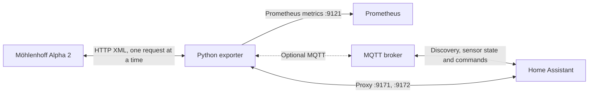

# Möhlenhoff (MQTT) Exporter

Export Möhlenhoff Alpha 2 heating-system data as Prometheus metrics. The MQTT-enabled exporter can also publish sensor state and Home Assistant MQTT auto-discovery messages, accepts target temperatures and presets over MQTT, and acts as a caching proxy so the Home Assistant integration no longer has to query the base stations itself.

## Architecture



## Requirements

- Python 3
- Network access from the exporter to each Möhlenhoff controller
- An MQTT broker only when using the MQTT-enabled exporter

## Install and run

Create a virtual environment and install the dependencies:

```sh
python3 -m venv .venv
. .venv/bin/activate
pip install -r requirements.txt
```

```sh
# Prometheus metrics plus MQTT / Home Assistant discovery
python moehlenhoff-mqtt-exporter.py
```

Both exporters listen on port `9121` and expose metrics at `/metrics`. Configure Prometheus to scrape the exporter, for example:

```yaml
scrape_configs:
  - job_name: moehlenhoff
    static_configs:
      - targets: ["localhost:9121"]
```

## Configuration

`moehlenhoff-mqtt-exporter.py` requires `PROXY_PORTS`, which lists each controller with its proxy port, for example `PROXY_PORTS="192.0.2.71:9171,192.0.2.72:9172"`. The scrape interval and HTTP port are configured near the top of the script. `moehlenhoff-cli.py` prints the rooms of each station once and reads the controllers from the same `PROXY_PORTS`, ignoring the ports.

MQTT is disabled unless `MQTT_BROKER` is set. The MQTT exporter uses port `1883` and the `homeassistant` discovery prefix. If your broker requires authentication, set both `MQTT_USER` and `MQTT_PASS`, for example:

```sh
export MQTT_BROKER="192.0.2.10"
export MQTT_USER="your-mqtt-user"
export MQTT_PASS="your-mqtt-password"
python moehlenhoff-mqtt-exporter.py
```

Keep credentials out of source control. The MQTT-enabled script can also run without a broker configured; in that case, MQTT publication is skipped and Prometheus metrics remain available.

## Home Assistant proxy

The exporter is meant to be the only client of the base stations. Each station gets its own proxy port, because the `moehlenhoff_alpha2` integration can only be given one host per base. Its host field accepts `host:port`, so add one integration entry per port, for example `192.0.2.1:9171` and `192.0.2.1:9172`.

- `GET /data/static.xml` is answered from the last valid scrape, with secrets masked. If there has been no valid scrape for 5 minutes (`CACHE_MAX_AGE`), the proxy answers `503` and Home Assistant shows the entities as unavailable rather than frozen.
- `POST /data/changes.xml` is forwarded to the station, so temperatures, presets, cooling and the time sync keep working. The station is read back 2 and 6 seconds later; a `GET` arriving in between waits for the first read-back.
- All requests to a station are serialized, so it never sees two at once.

The proxy has no authentication and listens on all interfaces. Set `PROXY_BIND` to restrict it to one address.

## Control over MQTT

Each room's climate entity is writable, with the same effect as the `moehlenhoff_alpha2` integration. The room settings of the base's web interface are writable too, as `number` entities in the device's configuration section:

| Action | Topic | Payload | Fields written |
| --- | --- | --- | --- |
| Set target temperature | `moehlenhoff/<ip>/room/<nr>/temperature/set` | for example `21.0` | `T_TARGET`, plus `T_HEAT_DAY` or `T_HEAT_NIGHT` in the day or night preset (`T_COOL_*` while cooling) |
| Set preset | `moehlenhoff/<ip>/room/<nr>/preset/set` | `auto`, `day` or `night` | `HEATAREA_MODE` |
| Set stored temperature | `moehlenhoff/<ip>/room/<nr>/<setting>/set` with `heat_day`, `heat_night`, `cool_day` or `cool_night` | for example `21.0` | `T_HEAT_DAY`, `T_HEAT_NIGHT`, `T_COOL_DAY` or `T_COOL_NIGHT` |
| Set target limits | `moehlenhoff/<ip>/room/<nr>/target_min/set` or `.../target_max/set` | for example `10.0` | `T_TARGET_MIN` or `T_TARGET_MAX` |
| Set temperature offset | `moehlenhoff/<ip>/room/<nr>/offset/set` | `-2.0` to `2.0` kelvin | `OFFSET` |

`<nr>` is the room's `HEATAREA` number. Temperatures outside the room's `T_TARGET_MIN` and `T_TARGET_MAX` are logged and ignored. The limits themselves stay within 5 to 30 °C, with the minimum below the maximum, and Home Assistant gets the new ranges through discovery. Out-of-range values are ignored the same way. So are retained messages, which would otherwise be replayed on every reconnect.

The climate entity's target is `T_TARGET`, the temperature the room is regulated to right now. In the `auto` preset, setting it changes only that value, so the web interface keeps showing the stored temperatures, which differ from the target until the base applies them again. Change the stored temperatures to set what the day and night periods use. In the `day` and `night` presets, setting the target also updates the stored temperature of that preset.

Rooms with analog thermostats report `0.0` for both limits and are set on the thermostat. Their climate entity is read-only, showing the station's mode, they have no presets or `number` entities, and commands for them are logged and ignored.

Commands use the same serialized path as the proxy. They run one at a time, each after the read-back of the one before, and only the newest value per room and setting is kept, so moving a slider does not flood the station. A failed write is logged and not retried; the entity then keeps showing the value read from the station.

### Vacation

Each station has two text entities for the vacation dates, a number entity for the vacation temperature and a button to remove the vacation, all in the device's configuration section:

| Action | Topic | Payload |
| --- | --- | --- |
| Set start or end date | `moehlenhoff/<ip>/vacation/start/set` or `.../end/set` | `DD.MM.YYYY` or `YYYY-MM-DD` |
| Set vacation temperature | `moehlenhoff/<ip>/vacation/temp/set` | 5 to 30 °C, for example `16.0` |
| Remove vacation | `moehlenhoff/<ip>/vacation/clear/set` | anything |

The entities show dates as `DD.MM.YYYY`, like the web interface, whatever the Home Assistant language; a date the station has not set shows with zeros. The MQTT state topic and the station itself keep `YYYY-MM-DD`. The web interface always sends both dates, so the exporter does too. A date is held until the two form a period, with the start not after the end, and only then written to the station. Until then the held date shows in the entity but is lost on a restart; removing the vacation drops it as well. The station then derives `VACATION_STATE`, which stays a read-only sensor.

### Cooling

The climate mode switches a whole station between `heat` and `cool`, like the `moehlenhoff_alpha2` integration: every writable room's climate entity publishes to `moehlenhoff/<ip>/cooling/set` with `heat` or `cool`, which writes `COOLING`, and all rooms of the station then show the new mode. The per-room "lock cooling" setting of the base's web interface is left to the station, the exporter does not evaluate it. A station that refuses the change reads back as before.

The entity's action is `heating` or `cooling` while a valve of the room is active (`HEATCTRL_STATE`), otherwise `idle`.

Anyone who can publish to these topics can change the heating, so restrict them on the broker if it has other clients.

## Read-only settings

The expert settings of the base are reported for monitoring only: pump, relay, emergency mode, valve and pump protection, antifreeze, eco, vacation and firmware values for each station, plus heating system, lock, floor, program and sensor values for each room. In Home Assistant they are diagnostic sensors, in the MQTT state topics they are additional keys, and in Prometheus they are `moehlenhoff_system_detail{ip,name}` and `moehlenhoff_room_detail{ip,room,name}`. Text values such as versions are not in Prometheus.

They are read from explicit lists, so that the secrets in `static.xml` stay out: the cloud credentials, the lock code and the expert code are never published, and neither are the network settings.

The stations' own `static.xml` does contain those secrets. The proxy replaces `PASSWORD`, `EXPERT` and `LOCK_CODE` with zeros of the same length in everything it returns. The rest, including the cloud user ID and the network settings, passes through unchanged and without authentication, so keep the proxy reachable from Home Assistant only.

## Metrics and availability

The exporter reports system status, room temperatures and states, valve openings, and wireless thermostat battery and signal readings. Metrics have an `ip` label, and room/device metrics include labels identifying the relevant room or device.

`moehlenhoff_up{ip="..."}` is `1` when the controller responds with valid XML and `0` when the request fails or the XML cannot be parsed. Missing, invalid, or non-finite readings are logged and omitted. This keeps unavailable measurements distinct from real readings of `0`. Old samples for a controller are cleared on each scrape so failed or incomplete reads do not leave stale values.

## Troubleshooting

- **`moehlenhoff_up` is `0`:** check the controller IP, network route, and that `http://<controller-ip>/data/static.xml` is reachable from the exporter host.
- **A metric is absent:** check the exporter logs for a missing or invalid XML value. Absent measurements are intentional; they are not filled with zero.
- **No Home Assistant entities:** confirm you are running `moehlenhoff-mqtt-exporter.py`, `MQTT_BROKER` is set, and the broker is reachable with the configured credentials. Check that Home Assistant MQTT discovery is enabled.
- **A climate entity ignores changes:** check the exporter logs for an ignored command or a failed write, and that the MQTT user may subscribe to `moehlenhoff/+/room/+/+/set`, `moehlenhoff/+/vacation/+/set` and `moehlenhoff/+/cooling/set`.
- **Port `9121` is already in use:** stop the other exporter process or change `PORT` in the selected script.
- **Home Assistant cannot reach the proxy:** check that it can reach ports `9171` and `9172` on the exporter host. A `503` means the exporter has no recent data from that station; check `moehlenhoff_up` and the exporter logs.

## License

[MIT](./LICENSE)
