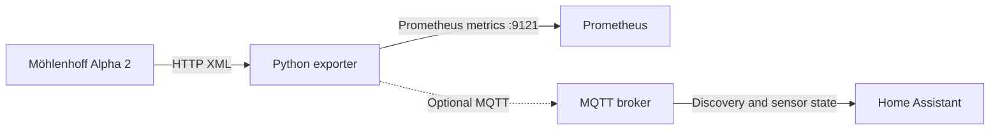

# Möhlenhoff (MQTT) Exporter

Export Möhlenhoff Alpha 2 heating-system data as Prometheus metrics. The MQTT-enabled exporter can also publish sensor state and Home Assistant MQTT auto-discovery messages.

## Architecture



## Requirements

- Python 3
- Network access from the exporter to each Möhlenhoff controller
- An MQTT broker only when using the MQTT-enabled exporter

## Install and run

Create a virtual environment and install the dependencies:

```sh
python3 -m venv .venv
. .venv/bin/activate
pip install -r requirements.txt
```

```sh
# Prometheus metrics plus MQTT / Home Assistant discovery
python moehlenhoff-mqtt-exporter.py
```

Both exporters listen on port `9121` and expose metrics at `/metrics`. Configure Prometheus to scrape the exporter, for example:

```yaml
scrape_configs:
  - job_name: moehlenhoff
    static_configs:
      - targets: ["localhost:9121"]
```

## Configuration

Edit the `IPS` list near the top of the selected script to match your controller addresses. The scrape interval and HTTP port are also configured there.

MQTT is disabled unless `MQTT_BROKER` is set. The MQTT exporter uses port `1883` and the `homeassistant` discovery prefix. If your broker requires authentication, set both `MQTT_USER` and `MQTT_PASS`, for example:

```sh
export MQTT_BROKER="192.168.1.10"
export MQTT_USER="your-mqtt-user"
export MQTT_PASS="your-mqtt-password"
python moehlenhoff-mqtt-exporter.py
```

Keep credentials out of source control. The MQTT-enabled script can also run without a broker configured; in that case, MQTT publication is skipped and Prometheus metrics remain available.

## Metrics and availability

The exporter reports system status, room temperatures and states, valve openings, and wireless thermostat battery and signal readings. Metrics have an `ip` label, and room/device metrics include labels identifying the relevant room or device.

`moehlenhoff_up{ip="..."}` is `1` when the controller responds with valid XML and `0` when the request fails or the XML cannot be parsed. Missing, invalid, or non-finite readings are logged and omitted. This keeps unavailable measurements distinct from real readings of `0`. Old samples for a controller are cleared on each scrape so failed or incomplete reads do not leave stale values.

## Troubleshooting

- **`moehlenhoff_up` is `0`:** check the controller IP, network route, and that `http://<controller-ip>/data/static.xml` is reachable from the exporter host.
- **A metric is absent:** check the exporter logs for a missing or invalid XML value. Absent measurements are intentional; they are not filled with zero.
- **No Home Assistant entities:** confirm you are running `moehlenhoff-mqtt-exporter.py`, `MQTT_BROKER` is set, and the broker is reachable with the configured credentials. Check that Home Assistant MQTT discovery is enabled.
- **Port `9121` is already in use:** stop the other exporter process or change `PORT` in the selected script.

## License

[MIT](./LICENSE)
